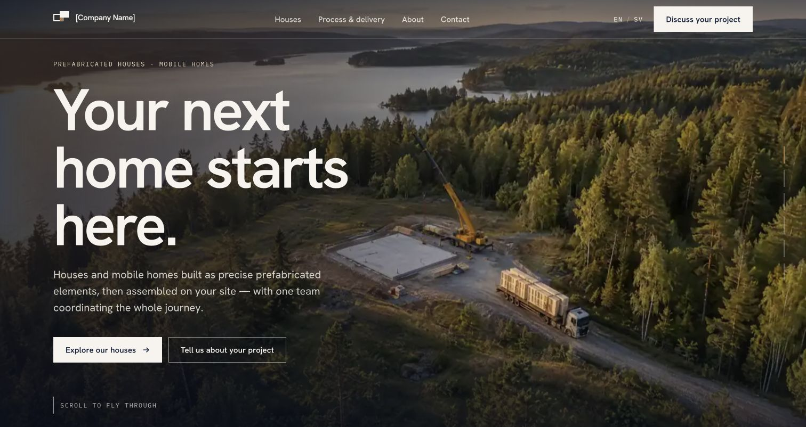

# Modular Homes — Interactive Website Concept

**[Open the website →](https://modular-house-r731p2zz1-ismails-projects-52d79716.vercel.app/en)**

A visual website concept for prefabricated houses and mobile homes, built by **Ismail Bellakhel**.

## Explore the website

- Experience the scroll-led journey from a building site to a finished home.
- Browse the house and mobile-home catalogue and product pages.
- Explore the process, delivery and enquiry pages.
- Switch between Swedish and English.
- Inspect concept visualisations and the interactive product presentation.

## Project status

This is a website concept/MVP, not a launched house manufacturer. The company name remains a placeholder, visuals are labelled as visualisations, and enquiries are in demo mode. Catalogue and imagery are shown as part of the existing concept site; this showcase does not claim completed construction projects, certified specifications or delivery guarantees.

This repository contains a screenshot and links to the existing hosted website. It does not publish the source project, backend, design files or implementation architecture.
